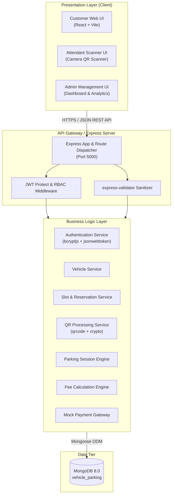

# Smart Vehicle Parking Management System

PES University, Bangalore  
Department of Computer Science and Engineering  
Course: UE24CS341A - Software Engineering (Level 3 Mini-Project)  
Semester: V Semester  
Group Number: 10  
Development Methodology: Agile (Scrum)  

---

## 1. Project Overview

The Vehicle Parking System is a full-stack, software-based parking management platform that automates the digital parking workflow for customers, parking attendants, and administrators. The application manages the end-to-end lifecycle of parking: user registration and authentication, customer vehicle management, slot reservations, QR-code entry and exit validation, parking session tracking, dynamic fee computation, mock payment processing, and audit reporting.

### Team Members & Contributions

| Member Name | Student ID (SRN) | Assigned Modules & Work Packages |
| :--- | :--- | :--- |
| **Roshan** | PES1UG24CS387 | Customer Registration, Login, Vehicle Management, Auth Middleware & RBAC, Password Hashing, Input Sanitization |
| **S Mayur** | PES1UG24CS391 | Parking Slot Model & APIs, Slot Availability UI, Reservation Model & APIs, Performance Testing |
| **Saima Kapoor** | PES1UG24CS403 | Parking Session Model & APIs, Fee Calculation Engine, Payment Processing, Customer History UI |
| **Rohan Jadar** | PES1UG24CS379 | QR Code Generation & Validation, Attendant Scanner UI, Admin Slot & Rate Management, Docker Infrastructure |

---

## 2. System Architecture

The application adopts a modular, 3-tier decoupled architecture separating presentation, business logic, and persistent storage.



### Module Flow

1. **Authentication & Vehicles**: User registers an account with an associated primary vehicle. Passwords are encrypted using bcrypt with salt rounds = 10. Access tokens are generated as signed JSON Web Tokens (JWT).
2. **Slot Selection & Booking**: Customers query real-time slot availability (2-wheelers and 4-wheelers) and place a reservation for an unoccupied slot.
3. **QR Validation & Check-in**: A unique, cryptographically signed QR code is generated for confirmed reservations. Parking attendants scan the QR code at the entry gate, recording entry timestamp and marking the slot as OCCUPIED.
4. **Checkout & Fee Calculation**: At exit, the QR code is scanned to fetch the active parking session. Duration is calculated, parking rates are applied, and mock payment is confirmed.
5. **Session Completion**: Upon successful payment, the session status updates to COMPLETED and the slot reverts to AVAILABLE.

---

## 3. Technology Stack

- **Frontend**: React 19, Vite, Tailwind CSS, Axios, Lucide Icons
- **Backend**: Node.js (v18/v20), Express.js (ES Modules)
- **Database**: MongoDB 8.0 with Mongoose ODM
- **Authentication**: JSON Web Tokens (JWT), bcryptjs
- **Validation**: express-validator
- **Testing**: Jest, Supertest, Babel Jest
- **CI/CD**: GitHub Actions (Multi-version Node.js matrix: 18.x and 20.x)
- **Containerization**: Docker, Docker Compose

---

## 4. Setup and Installation

### Prerequisites

- Node.js (v18.0.0 or higher, v20.x recommended)
- npm (v9.0.0 or higher)
- MongoDB (local instance running on port 27017 or MongoDB Atlas connection string)
- Docker & Docker Compose (optional, for containerized run)

### Local Environment Setup

1. **Clone the Repository**:
   ```bash
   git clone https://github.com/SaimaKapoor/SE-PARKING-PROJECT.git
   cd SE-PARKING-PROJECT
   ```

2. **Backend Configuration**:
   ```bash
   cd backend
   npm install
   ```
   Create a `.env` file in the `backend/` directory (or copy from `.env.example`):
   ```env
   PORT=5000
   MONGODB_URI=mongodb://127.0.0.1:27017/vehicle_parking
   JWT_SECRET=super_secret_jwt_key_pes_se_2026
   JWT_EXPIRES_IN=24h
   ```
   Start the backend development server:
   ```bash
   npm run dev
   # Server runs on http://localhost:5000
   ```

3. **Frontend Configuration**:
   ```bash
   cd ../frontend
   npm install
   ```
   Start the frontend development server:
   ```bash
   npm run dev
   # Vite development server runs on http://localhost:3000 (or http://localhost:3001)
   ```

### Docker Setup

To spin up the complete environment (Frontend + Backend + MongoDB) with health checks:
```bash
docker compose up --build
```
- Frontend: `http://localhost:3000`
- Backend API: `http://localhost:5000`
- Health check: `http://localhost:5000/api/health`
- MongoDB: `localhost:27017`

---

## 5. Environment Variables Reference

| Variable Name | Default Value | Description |
| :--- | :--- | :--- |
| `PORT` | `5000` | HTTP port on which the Express server listens |
| `MONGODB_URI` | `mongodb://127.0.0.1:27017/vehicle_parking` | Connection URI for the MongoDB database |
| `JWT_SECRET` | *(Required)* | Cryptographic secret key used to sign and verify JWT tokens |
| `JWT_EXPIRES_IN` | `24h` | Token expiration duration (e.g., `1h`, `24h`, `7d`) |

---

## 6. REST API Documentation

All API requests and responses use JSON format. Authenticated routes require an `Authorization: Bearer <token>` header.

### 6.1 Authentication Endpoints

#### `POST /api/auth/register`
Register a new customer account and create their primary vehicle record.
- **Request Body**:
  ```json
  {
    "name": "Jane Doe",
    "email": "jane@example.com",
    "password": "Password123",
    "phone": "9876543210",
    "vehicleNumber": "KA01AB1234"
  }
  ```
- **Response (201 Created)**:
  ```json
  {
    "success": true,
    "message": "User registered successfully",
    "data": {
      "user": {
        "id": "671...",
        "name": "Jane Doe",
        "email": "jane@example.com",
        "role": "customer"
      },
      "token": "eyJhbGciOi..."
    }
  }
  ```

#### `POST /api/auth/login`
Authenticate an existing customer, staff member, or administrator.
- **Request Body**:
  ```json
  {
    "email": "jane@example.com",
    "password": "Password123"
  }
  ```
- **Response (200 OK)**:
  ```json
  {
    "success": true,
    "data": {
      "user": {
        "id": "671...",
        "name": "Jane Doe",
        "email": "jane@example.com",
        "role": "customer"
      },
      "token": "eyJhbGciOi..."
    }
  }
  ```

#### `GET /api/auth/me`
Retrieve profile of currently authenticated user.
- **Headers**: `Authorization: Bearer <token>`
- **Response (200 OK)**:
  ```json
  {
    "success": true,
    "data": {
      "user": {
        "id": "671...",
        "name": "Jane Doe",
        "email": "jane@example.com",
        "role": "customer",
        "phone": "9876543210"
      }
    }
  }
  ```

---

### 6.2 Vehicle Management Endpoints

#### `GET /api/vehicles`
Fetch all vehicles belonging to the authenticated customer.
- **Headers**: `Authorization: Bearer <token>`
- **Response (200 OK)**:
  ```json
  {
    "success": true,
    "count": 1,
    "data": {
      "vehicles": [
        {
          "_id": "671...",
          "vehicleNumber": "KA01AB1234",
          "vehicleType": "4-wheeler",
          "model": "Honda City",
          "createdAt": "2026-10-31T08:00:00.000Z"
        }
      ]
    }
  }
  ```

#### `POST /api/vehicles`
Register a new vehicle under the authenticated customer.
- **Headers**: `Authorization: Bearer <token>`
- **Request Body**:
  ```json
  {
    "vehicleNumber": "KA05CD5678",
    "vehicleType": "2-wheeler",
    "model": "Royal Enfield Hunter"
  }
  ```
- **Response (201 Created)**:
  ```json
  {
    "success": true,
    "message": "Vehicle registered successfully",
    "data": {
      "vehicle": {
        "_id": "671...",
        "vehicleNumber": "KA05CD5678",
        "vehicleType": "2-wheeler",
        "model": "Royal Enfield Hunter"
      }
    }
  }
  ```

---

### 6.3 System Health Check

#### `GET /api/health`
System liveness and database connectivity probe used by Docker and CI checks.
- **Response (200 OK)**:
  ```json
  {
    "status": "UP",
    "backend": "connected",
    "database": "connected",
    "timestamp": "2026-10-31T09:00:00.000Z"
  }
  ```

---

## 7. Verification and Testing

### Backend Unit & Integration Tests

Automated test suites are executed using Jest and Supertest with an isolated in-memory or test database:
```bash
cd backend
npm test
```
Current automated test suites include:
- `tests/auth.test.js`: User registration, email format validation, duplicate email rejection, login credentials verification, and bcrypt hashing checks (UT-04).
- `tests/authMiddleware.test.js`: Bearer token extraction, invalid token rejection, expired token handling, role-based access control (RBAC), and customer vs staff vs admin permission checks (SEC-002, SEC-004).
- `tests/vehicle.test.js`: Customer vehicle registration, plate number formatting, vehicle listing isolation per user, and duplicate registration protection.

### Frontend Quality Assurance

```bash
cd frontend
npm run lint    # ESLint check across all JSX and JS files
npm run build   # Production Vite bundle build verification
```

### Continuous Integration (CI/CD)

The GitHub Actions workflow (`.github/workflows/ci.yml`) runs on every push and pull request against `main` and `develop`:
- **Code & Structure Health Check**: Verifies repository consistency.
- **Frontend CI**: Node.js 20.x environment running linting and Vite build.
- **Backend CI Matrix**: Node.js 18.x and Node.js 20.x running ESLint and Jest test suites.
- **Status Gate**: Requires all checks to pass before pull request merge eligibility.

---

## 8. Requirements Traceability

| Requirement ID | Module | Implementation File(s) | Test Suite |
| :--- | :--- | :--- | :--- |
| **FR-001** | User Auth & Vehicle | `backend/src/controllers/authController.js`<br>`frontend/src/components/Register.jsx` | `backend/tests/auth.test.js` |
| **FR-002** | Slot Availability | `backend/src/controllers/slotController.js` | `backend/tests/slot.test.js` |
| **FR-004** | QR Generation | `backend/src/controllers/qrController.js` | `backend/tests/qr.test.js` |
| **FR-005** | QR Validation | `backend/src/controllers/qrController.js` | `backend/tests/qr.test.js` |
| **FR-009** | Fee Calculation | `backend/src/services/feeCalculation.js` | `backend/tests/feeCalculation.test.js` |
| **FR-010** | Mock Payment | `backend/src/controllers/paymentController.js` | `backend/tests/paymentFlow.test.js` |
| **SEC-001** | Password Hashing | `backend/src/models/User.js` (bcryptjs salt 10) | `backend/tests/auth.test.js` |
| **SEC-002** | RBAC Middleware | `backend/src/middleware/authMiddleware.js` | `backend/tests/authMiddleware.test.js` |
| **SEC-003** | Input Sanitization | `backend/src/routes/authRoutes.js` (express-validator) | `backend/tests/auth.test.js` |
| **SEC-004** | Token Expiry Validation | `backend/src/middleware/authMiddleware.js` | `backend/tests/authMiddleware.test.js` |
